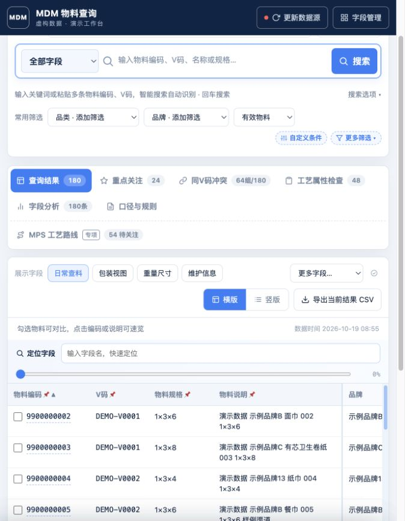

# MDM Advanced Query Console

一个面向主数据检索、字段核对与质量治理的本地工作台。使用原生 JavaScript 和 Python，可构建为单个 HTML 文件。

**此仓库是去敏演示版本，内置 192 条程序生成的虚构物料，不包含生产业务数据。** 演示编码、V 码、品牌、描述、人员、部门、条码与规格数值均由生成器独立构造。默认校验规则用于展示配置方式，可按实际需求修改。



## 快速开始

建议使用 Python 3.10+；Python 3.9+ 可运行启动器。运行现成页面不需要 Node.js。

```bash
git clone https://github.com/JeremyKueng/MDM-Advanced-Query-Console.git
cd MDM-Advanced-Query-Console
python3 -m venv .venv
source .venv/bin/activate
python3 -m pip install -r requirements.txt
python3 scripts/launch_workbench.py
```

Windows 激活环境使用 `.venv\Scripts\activate`。也可双击 `启动工作台.bat` / `启动工作台.command`。

页面地址为 `http://127.0.0.1:4173/mdm`。打开已经生成的 `outputs/MDM高级查询工作台.html` 可直接浏览内嵌演示数据；文件导入和本地配置保存使用 Python 服务。

## 主要功能

- **搜索与筛选**：关键词、物料编码、V 码、批量查码自动识别；日期、区间和可交替嵌套的 AND/OR 条件组。“包含任一项”支持中英文分号分隔，原“包含”保留完整文字匹配。
- **持续查询**：搜索框随滚动吸顶；清空保留范围和筛选；查询结果使用内嵌滚动表格、冻结列、字段定位及分页。
- **个人视图**：管理可见字段和顺序；自定义字段视图、一键切换、命名保存查询。
- **速览与详情**：半屏速览可配置区块、字段及顺序；完整详情支持模板、条件路由和字段拖拽。编码链接可直接进入完整详情。
- **治理分析**：异常关注、同 V 码规格冲突、字段分析、可编辑的工艺属性检查规则。支持条件树和受限算式，不执行用户代码。
- **MPS 专项**：工艺路线独立校验，状态、品类、问题类型联动；与常规 MDM 治理分开统计。
- **配置持久化**：本地独立 JSON 配置，包含视图、查询、规则和详情布局；代码更新不重置个人设置。

## 导入自己的数据

从“更新数据源”选择本地 `.xlsx` 文件，或运行：

```bash
python3 scripts/build_adv_query_dataset.py --source /path/to/materials.xlsx
python3 scripts/build_adv_query_workbench.py
```

Excel 列头必须包含“物料编码”；会在前 31 行中定位列头，按列名读取字段，缺失的列按空值处理。参考 `examples/materials-demo.xlsx` 的列名。导入后，数据会写入本地 `outputs/advq/dataset.json`、压缩数据集和生成 HTML；**重新上传仓库前须重新生成演示数据并运行发布检查**，因为这些文件会包含刚导入的记录。

默认不配置任何企业内网地址、不连接共享盘。需要共享目录时，在本机填写项目 `.env`，或在页面“连接与数据详情”保存共享目录；`.env` 不会纳入 Git。

- `MDM_SOURCE_XLSX`：可选默认 Excel 文件。
- `MDM_SHARE_UNC` / `MDM_SHARE_SMB`：自行配置的共享地址（首次迁移后以本机保存值为准）。
- `MDM_SHARE_DIRS`：本地已挂载目录，以当前系统的路径分隔符分隔。
- `MDM_WORKBENCH_CONFIG_DIR`：可选个人配置目录，在操作系统环境变量中设置；`.env` 只读取数据源路径。

默认配置保存在 macOS/Linux 的 `~/.config/mdm-advanced-query-console/`，Windows 的 `%APPDATA%\mdm-advanced-query-console\`。仓库不包含个人配置、浏览历史或导入文件。

## 重建演示版本

```bash
python3 scripts/generate_demo.py
python3 scripts/check_release.py
```

生成器只构造虚构记录，不读取生产表或个人规则。它会覆盖演示 Excel、两份数据集和生成 HTML；请先保留你自己的导入数据。

## 开发与测试

前端源文件在 `outputs/advq/advq.*.js` 和 `outputs/advq/template.html`；`scripts/build_adv_query_workbench.py` 将它们和压缩数据集组装为单文件 HTML。修改前端后运行该构建脚本。

```bash
python3 -m unittest discover -s tests -p 'test_*.py'
# 前端测试使用 Node.js 20+
node tests/test_advq_query.cjs
node tests/test_advq_conditions.cjs
node tests/test_advq_nested_filters.cjs
node tests/test_advq_workspace.cjs
node tests/test_advq_process.cjs
node tests/test_advq_governance.cjs
node tests/test_advq_mps.cjs
node tests/test_advq_quick_detail.cjs
node tests/test_advq_routing.cjs
node tests/test_advq_searchdock.cjs
node tests/test_advq_source_modal.cjs
```

去敏范围与发布约定见 [发布说明](docs/DEIDENTIFICATION.md)。


## 表头筛选与工具入口

- 查询表格仅点击表头右侧箭头可打开“筛选和排序”：按值搜索、全选/反选、多选后点“确定”生效；取消、点外部或按 Esc 放弃草稿。窗口优先显示在当前列右侧，空间不足时移到左侧；窄屏左右都放不下时在表格外展开，避免遮盖当前列。升序、降序、恢复默认排序和清除此列筛选都在同一菜单，数字按大小、日期按先后排序，空白放在最后。
- 候选值数量按当前搜索和其他筛选计算；每列内部多选取任一值，不同列与上方筛选取交集。候选值较多时分批显示，搜索与全选覆盖完整候选列表。按单元格显示值分组（数字沿用表格显示精度）；搜索后点确定仅应用匹配列表。
- 已生效的列筛选会在上方显示可删除的条件，即使隐藏该列或结果为空也能撤销。个人配置与“我的查询”均保存列筛选和排序（配置版本 8，继续读取旧版）。
- 日常页面保留“查询结果”和右侧“工具与分析”；专业看板放在结果区域的下一层，左侧分为 MDM 主数据治理和 MPS 专项。上方搜索与筛选仍可操作；返回查询结果保留字段、排序和表内滚动位置。
- 自定义条件的“等于任一项”匹配完整值，“包含任一项”匹配部分文本，“开头等于”按单个前缀匹配。

验证：`node tests/test_advq_columns.cjs` 与 `python3 -m unittest discover -s tests -p 'test_workbench_config.py'`。


## 共享路径与个人配置保存

在“更新数据源 → 连接与数据详情”填写 **共享目录**，点击 **保存共享路径**。支持 Windows UNC、映射盘符和 macOS SMB/挂载目录。共享路径保存在个人配置目录的 `source-settings.json`，个人视图、查询和规则保存在 `user-config.json`；两者位于项目之外，继续沿用本机保存值。

原有代码、环境变量、项目 `.env` 中的共享设置在首次使用时迁移；持久化设置优先。`.env` 只读取路径字面值，不执行脚本、不存账号密码。路径留空并保存可以清除共享配置。页面只提供物料数据的导入和刷新，程序版本由用户手动更新。

开发目录与正式运行目录可分开：在原目录放置被 Git 忽略的 `workbench-runtime.local.json`，内容为 `{"version":1,"directory":"正式克隆目录的绝对路径"}`。启动器会验证目标是本项目 GitHub 的 `main` 副本，再交给正式版启动，自动沿用原入口的个人配置目录。迁移前须把当前 `outputs/advq/dataset.json`、`dataset.b64` 复制到正式副本并重建 HTML；保留原目录即可回滚。正常的 GitHub 克隆安装不需要此文件。

## 核心视图的工艺字段

核心视图共 35 列，保留原有基础字段，并按分类、工艺特征、重量核对和箱规排列。包含压线/压花、层数、折数、纸长/纸宽、纸盒尺寸、中包包装方式、小卷形状、标准/迷你、张/片数、码数、产品系列、单/多片装、是否悬挂式、单包高度，以及成品定量、小卷/包净重、装数、包装层级和外包装尺寸。切换核心视图只改变展示字段，保留当前查询和筛选。
